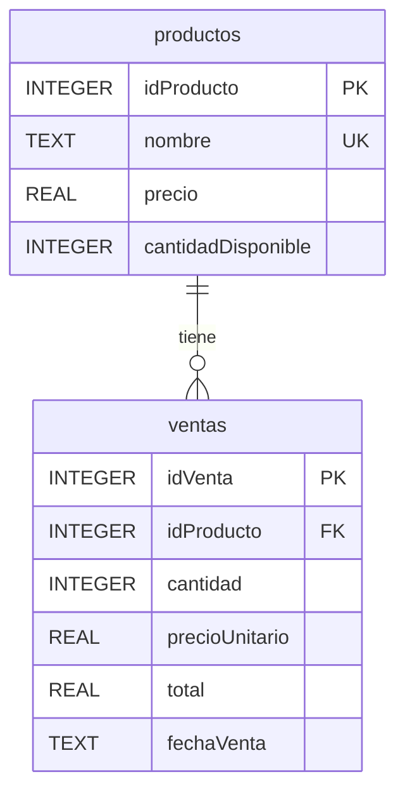
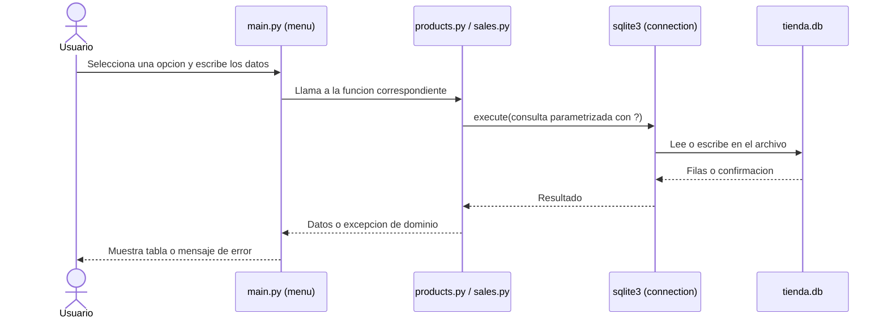
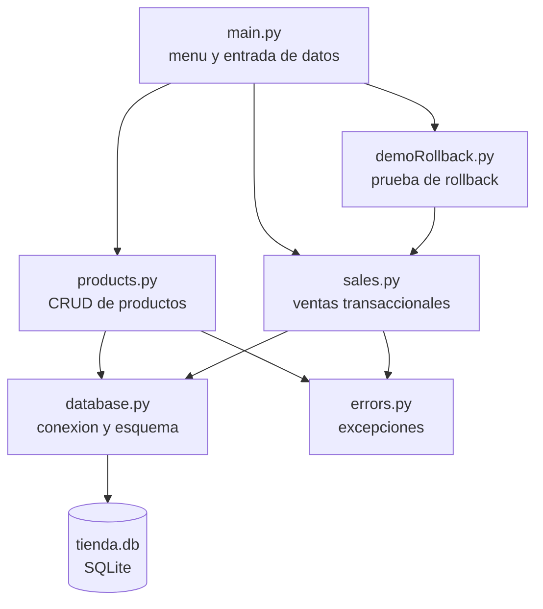

# Sistema de inventario y ventas
# NOMBRE: JUAN DIAZ
# GRUPO: 4E

Parcial practico de Acceso a Datos. Aplicacion de consola en Python con SQLite para administrar los productos de una tienda de componentes electronicos y registrar ventas sin dejar el inventario inconsistente.

## Requisitos

- Python 3.8 o superior
- No requiere instalar librerias externas (solo usa `sqlite3`, incluida en Python)

## Como ejecutar

```bash
git clone <[urlDelRepositorio](https://github.com/cammxw/DESARROLLO-DE-APLICACIONES-CON-ACCESO-A-DATOS-PARCIAL-2.git)>
cd tiendaInventario
python main.py
```

La base de datos `tienda.db` y sus tablas se crean automaticamente la primera vez que se ejecuta el programa.

Para ejecutar la demostracion del rollback como script independiente:

```bash
python demoRollback.py
```

Para ejecutar las pruebas automaticas:

```bash
python -m unittest testSales -v
```

## Estructura del proyecto

| Archivo | Responsabilidad |
|---|---|
| `main.py` | Menu interactivo y lectura de datos del usuario |
| `database.py` | Conexion a SQLite, activacion de claves foraneas y creacion de tablas |
| `products.py` | CRUD de productos y sus validaciones |
| `sales.py` | Registro transaccional de ventas e historial con JOIN |
| `errors.py` | Excepciones propias del dominio |
| `demoRollback.py` | Demostracion del rollback con un error controlado |
| `testSales.py` | Pruebas automaticas con `unittest` |

## Parte 1. Analisis y diseno

### Entidades y atributos

**Producto**: idProducto, nombre, precio, cantidadDisponible.

**Venta**: idVenta, idProducto, cantidad, precioUnitario, total, fechaVenta.

Un producto puede tener muchas ventas y cada venta pertenece a un solo producto (relacion uno a muchos).

### Modelo de datos



Restricciones definidas en la base de datos:

- `productos.nombre` es unico y no nulo.
- `productos.precio >= 0` y `productos.cantidadDisponible >= 0` (`CHECK`), por lo que el inventario nunca puede quedar negativo.
- `ventas.cantidad > 0` (`CHECK`).
- `ventas.idProducto` es clave foranea hacia `productos.idProducto` con `ON DELETE RESTRICT`.
- Se ejecuta `PRAGMA foreign_keys = ON` en cada conexion, porque SQLite no valida claves foraneas por defecto.
- `ventas.precioUnitario` guarda el precio al momento de la venta, asi el historial no cambia si el precio del producto se actualiza despues.

### Diagrama de interaccion usuario, Python y SQLite



### Operaciones al registrar una venta

1. Validar que la cantidad solicitada sea mayor que cero.
2. Abrir la transaccion con `BEGIN IMMEDIATE`.
3. Consultar el producto y verificar que exista.
4. Verificar que `cantidadDisponible` alcance para la cantidad pedida.
5. Insertar la fila en `ventas` con el precio vigente y el total.
6. Descontar la cantidad vendida en `productos`.
7. Ejecutar `commit()` para confirmar ambas escrituras como una sola unidad.
8. Si cualquier paso falla, ejecutar `rollback()` y propagar el error.

## Parte 2. Analisis de como esta construido el software

### Arquitectura



El programa esta separado en capas simples:

- **Presentacion**: `main.py` solo pide datos, imprime resultados y captura las excepciones de dominio para mostrar mensajes claros.
- **Logica de negocio**: `products.py` y `sales.py` contienen las reglas (validaciones, transaccion de venta) y no imprimen nada.
- **Acceso a datos**: `database.py` centraliza la conexion, el `row_factory` para leer columnas por nombre y la creacion de tablas con `CREATE TABLE IF NOT EXISTS`.
- **Errores**: `errors.py` define excepciones propias para no depender de mensajes de texto al decidir que hacer ante un fallo.

### Decisiones de diseno

- Todas las consultas usan parametros `?`; nunca se concatenan datos del usuario en el SQL.
- Eliminar un producto con ventas asociadas se rechaza con un mensaje claro, tanto por una verificacion previa como por `ON DELETE RESTRICT` en la base de datos. Asi se conserva el historial de ventas.
- Las funciones de actualizacion y eliminacion verifican que el producto exista antes de modificar.
- El historial de ventas se obtiene con `INNER JOIN` entre `ventas` y `productos` para mostrar el nombre del producto.

## Parte 3. Explicacion de la transaccion

La funcion `registerSale` en `sales.py` agrupa en una sola transaccion el insert en `ventas` y el update en `productos`:

```python
connection.execute("BEGIN IMMEDIATE")
connection.execute("SELECT ... FROM productos WHERE idProducto = ?")
connection.execute("INSERT INTO ventas ...")
connection.execute("UPDATE productos SET cantidadDisponible = cantidadDisponible - ? ...")
connection.commit()
```

Si ocurre cualquier excepcion entre el inicio y el `commit()`, el bloque `except` ejecuta `connection.rollback()`, que deshace todo lo escrito dentro de la transaccion. Con esto es imposible que quede una venta registrada sin su descuento de inventario, que era el problema original de la tienda.

### Reto obligatorio: error controlado

`registerSale` recibe el parametro `simulateFailure`. Cuando es verdadero, lanza `SimulatedFailureError` justo despues de insertar la venta y antes de actualizar el inventario. La demostracion (opcion 8 del menu o `python demoRollback.py`) hace lo siguiente:

1. Muestra el stock y la cantidad de ventas antes de la operacion.
2. Intenta la venta con la falla simulada.
3. Captura el error, con el `rollback()` ya aplicado.
4. Muestra el stock y la cantidad de ventas despues, y comprueba que son iguales a los iniciales.

Salida real:

```
Antes   -> stock: 50 | ventas registradas: 0
Intentando vender 5 unidad(es) con falla simulada...
Error capturado: Error controlado despues de registrar la venta y antes de actualizar el inventario
Se ejecuto rollback() sobre toda la operacion
Despues -> stock: 50 | ventas registradas: 0
Resultado: datos intactos
```

Tambien hay una prueba automatica (`testRollbackKeepsDataIntact`) que verifica este comportamiento y que la conexion no queda con una transaccion abierta.
